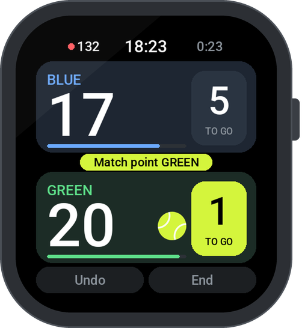

  

  
  
  
  

  <a href="#-get-it-on-your-watch">Install</a> ·
  <a href="#-features">Features</a> ·
  <a href="CHANGELOG.md">What's new</a> ·
  <a href="#-testers-wanted">Testers wanted</a> ·
  <a href="docs/DEVELOPMENT.md">Development</a>

<h3 align="center">
  Tap your side, play the next point. 
  Your watch keeps the score – and calls it out loud.
</h3>

 

  
  &nbsp;
  
  &nbsp;
  

## 🎾 Made for the court

<table>
  <tr>
    <td width="33%" valign="top">
      <h4>👆 One tap per point</h4>
      
Big team cards, readable in bright sun. Games, sets, tiebreaks, serve and change of ends are tracked for you.

      <h4></h4>
    </td>
    <td width="33%" valign="top">
      <h4>🔊 Score calls</h4>
      
“Thirty – fifteen”, “deuce”, “advantage”: the watch calls the score after every point, offline, in English.

      <h4></h4>
    </td>
    <td width="33%" valign="top">
      <h4>🏆 Your rules</h4>
      
Advantage, Golden Point or Star Point. One set or best of 3, short sets to 4, match tiebreak to 7 or 10.

      <h4></h4>
    </td>
  </tr>
  <tr>
    <td valign="top">
      <h4>⏰ Court timer</h4>
      
Set when your booking ends. A firm buzz 5, 10 or 15 minutes before, even with the app closed.

      <h4></h4>
    </td>
    <td valign="top">
      <h4>🔄 Change of ends</h4>
      
After games 1, 3, 5 … with a double vibration, plus an optional rest timer of 90 s or 2 min.

      <h4></h4>
    </td>
    <td valign="top">
      <h4>↩️ Oops-proof</h4>
      
Undo as many points as you like, even a mistyped winning point, until you tap “End”. An unfinished match is saved and waits for you.

      <h4></h4>
    </td>
  </tr>
</table>

## ✨ Features

**🏆 Rules**

- **Scoring:** Advantage, Golden Point or Star Point
- **Format:** 1 set or best of 3 · sets to 6, or short sets to 4 with a tiebreak at 4:4
- **Third set:** normal, without tiebreak (FIP rule 1.4), or a match tiebreak to 7 or 10
- **Change of ends:** after games 1, 3, 5 … (official), only after a set, or never
- **Rest timer** (optional): 90 s at a change of ends, 2 min after a set, as FIP rules allow

**⌚ On court**

- **Your point of view:** your team at the bottom, a lime bar shows who serves from which side
- **Who serves first:** pick a team, or let a spinning racket decide (a fair 50:50)
- **Score call** (optional): in English, the padel standard, offline, low or high volume
- **Undo** any number of points, even the winning one until you tap “End”
- **Court time:** a firm buzz before your booking ends, even with the app closed
- **Heart rate, clock and match time** on screen
- **Training:** points only, a race to 7, 11, 15 or 21, or an Americano with 16, 24 or 32 points

**⚙️ Around the match**

- **Team names and colors:** names up to 8 characters, 8 colors
- **History** of the last 30 matches
- **Languages:** English, German, Spanish, Italian and French
- **Battery-friendly:** redraws only what changes, wakes the watch once a minute
- **Diagnostics:** tap the logo on the info page (Options → i) 5 times for watch, storage and error log

## ⌚ Get it on your watch

Padel Punto runs on the square Amazfit watches **Bip 6**, **Active 2 (Square)** and **Bip Max** (Zepp OS 4 or newer). It is not in the Zepp app store yet;
grab the newest version from the **[Releases](https://github.com/fat-toni/PadelPunto/releases/latest)**.

| | 📱 With the Zepp app | 🤖 With Gadgetbridge |
|---|---|---|
| **For you if** | you use the Zepp app (iPhone or Android) | you already use [Gadgetbridge](https://gadgetbridge.org) on Android instead of the Zepp app |
| **You need** | a computer with Node.js | nothing else |
| **How** | run `zeus preview`, scan the QR code | open the `.zab` file from the release with Gadgetbridge |

👉 **[Step-by-step guide](docs/INSTALL.md)** for both ways (Windows, macOS and Linux)

## 🙋 Testers wanted

> [!TIP]
> **Got another Amazfit watch with Zepp OS 4+?** Padel Punto is made for the square Bip 6, Active 2 (Square) and Bip Max, and I would love to bring it to
> more watches, for example with round screens like the Active 2, Balance or T-Rex 3.
>
> 1. Open an **[issue](https://github.com/fat-toni/PadelPunto/issues/new?title=Tester:%20)** with your watch model and
>    its Zepp OS version (on the watch: Settings → About).
> 2. You get a test build for your watch.
> 3. Play a match or two and tell me what looks wrong. Photos of the watch help a lot.

## 🧪 Tested like a final

Every rule is checked against **28,800 simulated matches**, and the whole app runs on a simulated watch that gets
**18,000 random taps and swipes**. Curious, or want to help? See **[Development](docs/DEVELOPMENT.md)**.

---

  Made with 🎾 for padel players by Toni &amp; Claude AI · Code: <a href="LICENSE">GPL-3.0</a> © 2026 Toni · Voices: see <a href="CREDITS.md">credits</a>

