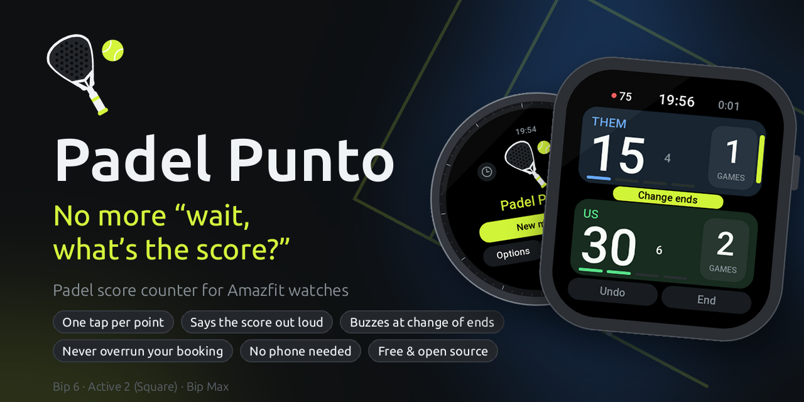
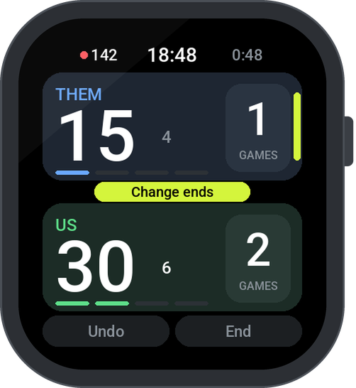
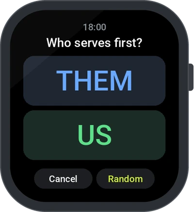
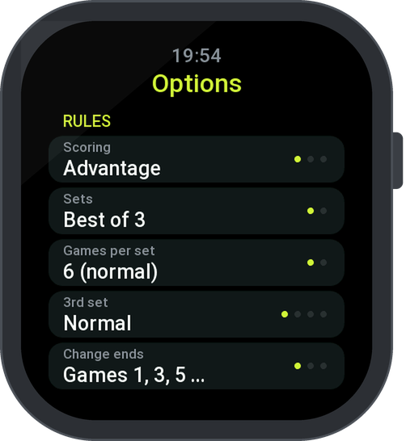

  

  <b><a href="#-get-it-on-your-watch">Install</a></b> ·
  <b><a href="#-all-features">Features</a></b> ·
  <b><a href="CHANGELOG.md">What's new</a></b> ·
  <b><a href="#-testers-wanted">Testers wanted</a></b> ·
  <b><a href="docs/DEVELOPMENT.md">Development</a></b>

<h3 align="center">
  Tap your side, play the next point. 
  Your watch keeps the score – and calls it out loud.
</h3>

 

  
  &nbsp;
  
  &nbsp;
  

## 🎾 Made for the court

<table>
  <tr>
    <td width="33%" valign="top">
      <h4>👆 One tap per point</h4>
      
Big team cards, readable in bright sun. Games, sets, tiebreaks, serve and change of ends are tracked for you.

      <h4></h4>
    </td>
    <td width="33%" valign="top">
      <h4>🔊 Score calls</h4>
      
“Thirty – fifteen”, “deuce”, “advantage”: the watch calls the score after every point, offline, in English.

      <h4></h4>
    </td>
    <td width="33%" valign="top">
      <h4>🏆 Your rules</h4>
      
Advantage, Golden Point or Star Point. One set or best of 3, short sets to 4, match tiebreak to 7 or 10.

      <h4></h4>
    </td>
  </tr>
  <tr>
    <td valign="top">
      <h4>⏰ Court timer</h4>
      
Set when your booking ends. A firm buzz 5, 10 or 15 minutes before, even with the app closed.

      <h4></h4>
    </td>
    <td valign="top">
      <h4>🔄 Change of ends</h4>
      
After games 1, 3, 5 … with a double vibration, plus an optional rest timer of 90 s or 2 min.

      <h4></h4>
    </td>
    <td valign="top">
      <h4>↩️ Oops-proof</h4>
      
Undo as many points as you like. An unfinished match is saved and waits for you.

      <h4></h4>
    </td>
  </tr>
</table>

## 📋 All features

- **Scoring modes:** Advantage, Golden Point or Star Point.
- **Match formats:** 1 set or best of 3; sets to 6 games or short sets to 4 (tiebreak at 4:4).
  Third set as a normal set, without tiebreak (play on at 6:6 until two games ahead, FIP rule 1.4),
  or as a match tiebreak to 7 or to 10.
- **Your point of view:** your team at the bottom, the opponents at the top, each card tinted in its team color.
  A green bar on the card shows who serves and from which side, as you see it on court.
- **Who serves first:** pick a team, or let a spinning padel racket decide (a fair 50:50 draw).
- **Change of ends** after games 1, 3, 5 … (official rule), only after a set, or never, with a double vibration or just a hint on screen.
- **Rest timer** (optional): counts down 90 s at a change of ends and 2 minutes after a set, as FIP rules allow.
- **Score call** (optional): serving team first, tiebreak numbers too, and the winner's team color when a game is won.
  An offline voice in English (the padel standard), with low or high volume.
- **Undo** any number of points.
- **Court time:** a firm vibration 5, 10 or 15 minutes before your booking ends and when time is up, even when the app is closed.
- **Team names and colors:** names up to 8 characters via the watch keyboard, 8 colors to choose from.
- **History** of the last 30 matches.
- **Heart rate, clock and match time** on screen; heart rate can be turned off to save battery.
- **Battery-friendly:** widgets only redraw when their value changes, and the clock wakes the watch only once a minute.
- **Diagnostics:** tap the logo on the info page 5 times quickly to see the watch model, Zepp OS and API level, app storage and the error log.

## ⌚ Get it on your watch

Padel Punto runs on the **Amazfit Bip 6** (Zepp OS 4 or newer). It is not in the Zepp app store yet.
Grab the newest version from the **[Releases](https://github.com/fat-toni/PadelPunto/releases)** and install it:

- **With the Zepp app:** install Node.js, download Padel Punto, run `zeus preview` and scan the QR code with your phone.
- **With [Gadgetbridge](https://gadgetbridge.org):** open the `.zab` file from the release on your phone.

👉 **[Step-by-step guide](docs/INSTALL.md)** (Windows, macOS and Linux)

## 🙋 Testers wanted

Padel Punto is made for the Bip 6, but I would love to bring it to **more Amazfit watches** with Zepp OS 4 or newer,
for example with round screens like the Active 2, Balance or T-Rex 3.
I only have a Bip 6, so I need people who play padel and **own another Amazfit watch** to try test builds on court.

How you can help:

1. Open an **[issue](https://github.com/fat-toni/PadelPunto/issues/new?title=Tester:%20)** with your watch model
   and its Zepp OS version (on the watch: Settings → About).
2. You get a test build for your watch.
3. Play a match or two and tell me what looks wrong or does not fit on the screen. Photos of the watch help a lot.

## 🧪 Tested like a final

Every rule is checked against 28,800 simulated matches, and the whole app runs on a simulated watch that gets 18,000 random taps and swipes.
Curious, or want to help? See **[Development](docs/DEVELOPMENT.md)**.

---

  
  
  
   
  Made with 🎾 for padel players by Fat Toni &amp; Claude · Code: <a href="LICENSE">GPL-3.0</a> © 2026 Fat Toni · Voices: see <a href="CREDITS.md">credits</a>

